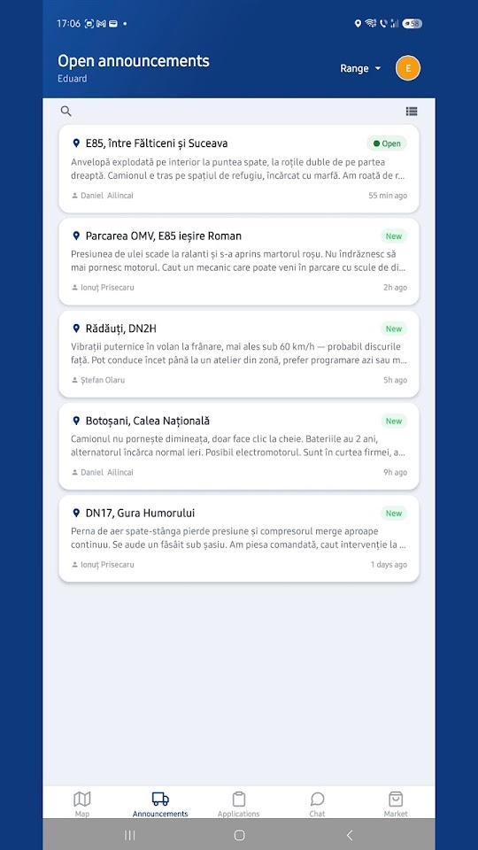
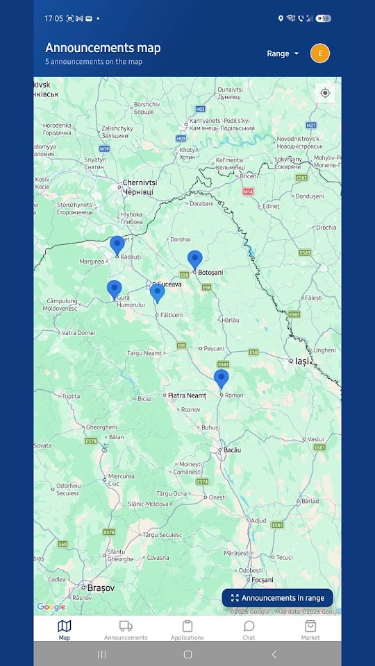
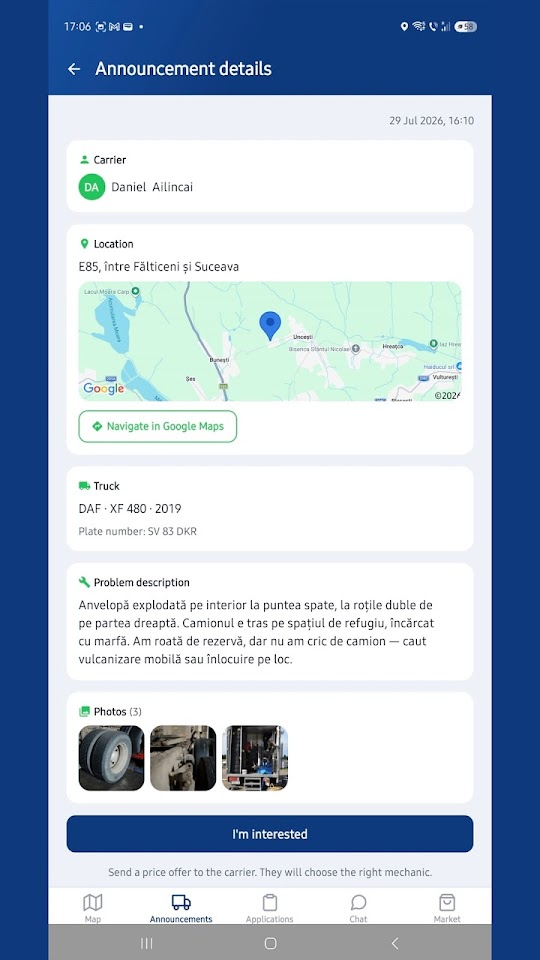
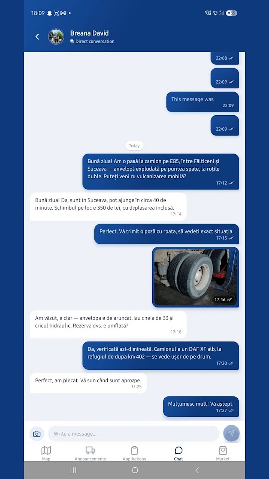
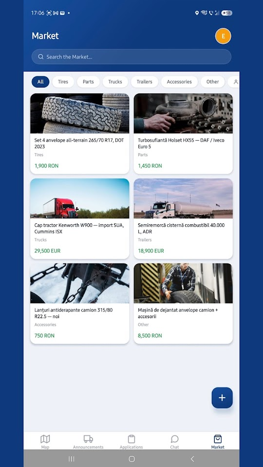
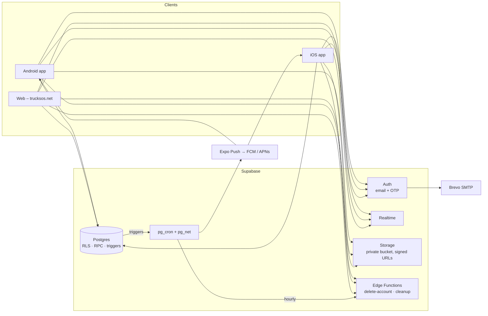

<p align="center">
  
</p>

<h1 align="center">TruckSOS</h1>

<p align="center">
  Roadside assistance for trucks — carriers post a breakdown, nearby mechanics answer with an offer.<br/>
  Live on Android, iOS and the web.
</p>

<p align="center">
  <a href="https://github.com/Andeaf/TruckSOS/actions/workflows/ci.yml"></a>
  
  
  
  
  
</p>

<p align="center">
  <a href="https://play.google.com/store/apps/details?id=com.andeaf.trucksos"><b>Google Play</b></a> ·
  <a href="https://apps.apple.com/app/id6801003473"><b>App Store</b></a> ·
  <a href="https://trucksos.net"><b>trucksos.net</b></a>
</p>

---

## What it does

A truck breaks down on the E85 at night. The driver opens TruckSOS, describes the problem, attaches a few photos and their GPS position, and posts it. Mechanics in range get a push notification, see the job on a map, and send a price offer. The driver picks one, a private chat opens, and the mechanic drives out. When the job is done the driver rates the mechanic.

Around that core flow the app also has a community channel for carriers and mechanics, a classifieds **Market** (tyres, parts, trucks, trailers), and an admin console for moderation.

TruckSOS is a solo project: product, design, mobile app, backend, releases and support. It has been in production since September 2026 and has ~900 registered users, mostly Romanian carriers and workshops.

## Screenshots

<p align="center">
  
  
  
  
  
</p>

## Features

**Carriers (drivers)**
- Post a breakdown with description, photos, saved truck (make / model / plate / VIN) and GPS location
- Receive offers (fixed or hourly), accept one → private chat; mark as resolved, repost, or cancel
- Announcements expire automatically after 30 h if nobody is accepted
- Search mechanics by name / specialisation / area, keep favourites, rate after the job

**Mechanics**
- Feed + map of open announcements, filtered by distance from the workshop
- "I'm interested" with a price offer; edit / withdraw / resubmit; see own applications
- Push notifications for new jobs within range, opt-out per channel

**Everyone**
- Private chat with photos, video, files, replies, edits, delete-for-everyone, read receipts and `@mentions`
- Public community channel; Market listings with categories, photos and direct contact
- Shareable profile links (`trucksos.net/p/<id>`) with Android App Links / iOS Universal Links
- Block and report users; GDPR self-service account deletion
- Romanian, English and German; light and dark theme; "new version available" prompt

**Admin**
- Dashboard with charts (new users, announcements), report queue with conversation context
- Ban / unban, edit profiles, delete content, full audit log; admin can also act as driver or mechanic

## Tech stack

| Layer | Choice |
|---|---|
| App | [Expo SDK 54](https://docs.expo.dev/versions/v54.0.0/) · React Native 0.81 · TypeScript (strict) · Expo Router (file-based routing) |
| State / data | React hooks + context, `@supabase/supabase-js` with generated DB types |
| Maps | `react-native-maps` — Google Maps on Android & web, Apple Maps on iOS |
| i18n | `i18next` / `react-i18next`, ~900 keys × 3 languages, OS locale detection |
| Backend | [Supabase](https://supabase.com): Postgres, Auth (email + OTP), Row Level Security, RPC, Realtime, Storage, Edge Functions |
| Jobs & push | `pg_cron` + `pg_net` call Expo Push directly from database triggers; hourly cleanup job |
| Email | Brevo SMTP (verification codes, password reset) |
| Web | Static export on Cloudflare Pages with CSP, HSTS and `X-Frame-Options: DENY` |
| Builds | EAS Build & Submit, remote credentials, auto-incremented version codes |

## Architecture



Design decisions worth calling out:

- **Database as the backend.** Business rules live in Postgres: every table has RLS, every sensitive write goes through a `SECURITY DEFINER` RPC (`accept_application`, `block_user`, `admin_*`, …), and triggers guard privileged columns so a client can never promote itself, change ratings or edit someone else's data — even with a valid session token.
- **Push from the database.** Notification fan-out is a trigger → `pg_net` HTTP call to Expo Push, with per-user language, batching for busy channels and a cooldown to avoid duplicate alerts. No separate worker to run.
- **Offline-tolerant chat.** Messages are reconciled after the app comes back from background; Realtime is a hint, the database is the source of truth.
- **Schema as migrations.** 80+ ordered SQL migrations in `supabase/migrations`; client types are generated from the live schema (`npm run gen:types`).

## Security

- RLS enabled on all 25 tables; no write policy is `true`
- Internal functions (`_purge_user_data`, `notify_push`, rating recomputation, …) are not executable by `anon`/`authenticated`; new functions do **not** get `EXECUTE` by default (`ALTER DEFAULT PRIVILEGES`)
- All `SECURITY DEFINER` functions pin `search_path`
- Private storage bucket with per-file size limits and signed, short-lived URLs
- Account deletion runs server-side and purges all personal data (GDPR)
- Auth rate limits tuned per endpoint; no secrets in the client (the anon key is public by design and gated by RLS)
- A read-only security checklist (RLS coverage, function privileges, default ACLs, bucket settings, trigger presence) is run against production before every release

See [SECURITY.md](SECURITY.md) for how to report a vulnerability.

## Project structure

```
src/
  app/                 Expo Router routes
    (auth)/            sign-in, sign-up, OTP, role selection, banned screen
    (driver)/          carrier tabs: announcements, chat, market, profile
    (mechanic)/        mechanic tabs: feed, map, applications, chat, market, profile
    (admin)/           moderation console
    p/[id].tsx         public profile deep link
  components/          UI (themed primitives, chat, announcement screens, map, pickers)
  hooks/               data hooks (use-announcements, use-chat, use-market, use-admin, …)
  lib/                 Supabase client, push, storage, location, linking, validation
  i18n/                i18next setup + ro / en / de resources
  types/               domain types + generated Supabase schema
supabase/
  migrations/          ordered SQL migrations (schema, RLS, RPC, triggers, cron)
  functions/           Edge Functions (Deno): delete-account, cleanup-announcements
web/                   legal pages (privacy, terms, account deletion) served at trucksos.net
public/                web static assets, App Links / Universal Links files, CSP headers
scripts/               web deploy script (Cloudflare Pages)
```

## Running locally

Requirements: Node 22+, npm, a Supabase project.

```bash
git clone https://github.com/Andeaf/TruckSOS.git
cd TruckSOS
npm install
cp .env.example .env        # EXPO_PUBLIC_SUPABASE_URL + EXPO_PUBLIC_SUPABASE_ANON_KEY
npx expo start
```

Backend setup for a fresh Supabase project:

```bash
npx supabase link --project-ref <your-ref>
npx supabase db push                         # applies supabase/migrations in order
npx supabase functions deploy delete-account
npx supabase functions deploy cleanup-announcements
npm run gen:types                            # regenerate src/types/supabase.ts
```

Maps and push notifications need a development build (`npx expo run:android` / `run:ios` or an EAS dev client); the rest works in Expo Go and in the browser.

### Scripts

| Command | What it does |
|---|---|
| `npm start` | Expo dev server |
| `npm run android` / `ios` / `web` | Dev server targeting a platform |
| `npm run lint` | ESLint (Expo config) |
| `npm run typecheck` | `tsc --noEmit` |
| `npm run gen:types` | Generate DB types from the linked Supabase project |
| `powershell -File scripts/deploy-web.ps1` | Export the web build and deploy to Cloudflare Pages |

## Release process

1. Bump `expo.version` in `app.json`, write the store "What's new" text (EN / RO / DE)
2. `eas build --platform all --profile production` → `eas submit`
3. Android and iOS are released together; the web build is deployed the same day
4. Update the `app_versions` table so older clients see the "new version available" prompt

## License

Source-available, **all rights reserved** — the code is published for reference and portfolio
purposes and may not be copied or reused. See [LICENSE](LICENSE).
