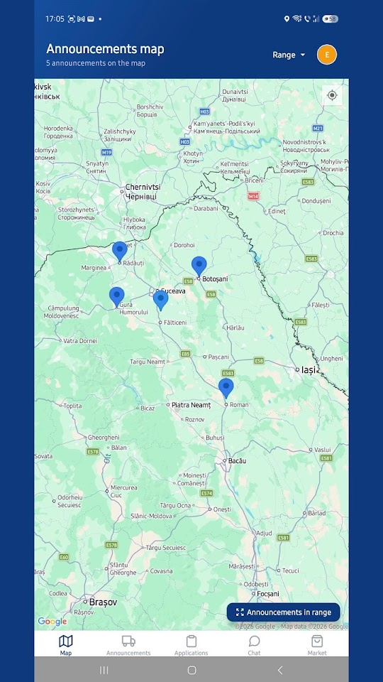
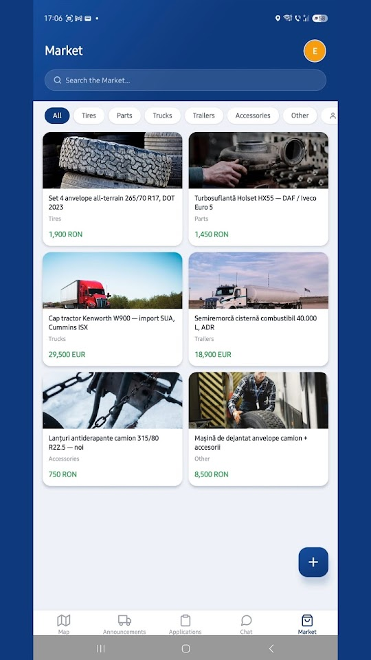

<p align="center">
  
</p>

<h1 align="center">TruckSOS</h1>

<p align="center">
  A roadside-assistance app for trucks: a carrier posts a breakdown with photos and GPS position,<br/>
  nearby mechanics get notified and answer with a price offer.
</p>

<p align="center">
  <a href="https://github.com/Andeaf/TruckSOS/actions/workflows/ci.yml"></a>
  
  
  
  
  
</p>

<p align="center">
  <a href="https://apps.apple.com/app/id6801003473"><b>App Store</b></a> ·
  <a href="https://play.google.com/store/apps/details?id=com.andeaf.trucksos"><b>Google Play</b></a> ·
  <a href="https://trucksos.net"><b>trucksos.net</b></a>
</p>

<p align="center">
  
  
</p>

<p align="center"><sub>Demo content. The interface is shown in English; the listings themselves are written in Romanian.</sub></p>

## The problem and the users

A truck that breaks down on the road is far from its usual workshop, and the driver rarely knows who repairs trucks
nearby, so they end up phoning around. Mobile mechanics have the opposite problem: they cannot know that a job is waiting
20 km away.

TruckSOS connects the two. A **carrier** describes the problem, attaches photos, the truck and the GPS position, and posts
it. **Mechanics** in range get a push notification, see the job in a feed and on a map, and send a price offer. The carrier
accepts one, a private chat opens (photos, video, files, phone call), and afterwards rates the mechanic. Around this flow
the app has a community channel, a classifieds **Market** (tyres, parts, trucks, trailers) and an **admin** console for
moderation. The interface is in Romanian, English and German.

It is a solo project: product, design, the app, the backend, releases and user support.

## Stack

| | |
|---|---|
| App | React Native 0.81 · [Expo SDK 54](https://docs.expo.dev/versions/v54.0.0/) · Expo Router · TypeScript (strict) — one codebase for Android, iOS and web |
| Backend | [Supabase](https://supabase.com): Postgres with Row Level Security, RPC functions, triggers and `pg_cron` · Auth · Realtime · Storage (private bucket, signed URLs) · Edge Functions in Deno |
| Push, maps, i18n | Expo Push (FCM / APNs) · `react-native-maps` · `i18next`, about 1,200 keys in 3 languages |
| Web | Static export on Cloudflare Pages, with CSP and HSTS headers |
| CI | GitHub Actions: ESLint, `tsc`, Vitest, Deno tests for the Edge Functions, and a database job that builds the schema from scratch on a local Supabase stack and runs pgTAP |

## Engineering decisions

Items marked **1.1** are merged in `main` and reach production with the next release; the rest is live today.

1. **Postgres is the backend, and the client is never trusted.** Every table has RLS. The two most exposed tables
   (`profiles`, `announcements`) live in a private `app` schema; clients read `security_invoker` views that mask the
   sensitive columns. A phone number is visible only to its owner and to admins; plate, VIN and exact coordinates only to
   the driver, the accepted mechanic and admins, while everyone else gets a position rounded to about 1 km. Privileged
   writes go through `SECURITY DEFINER` functions with a pinned `search_path`, and new functions get no `EXECUTE` by
   default. CI rejects a migration that creates a table without RLS and explicit grants, or a function without
   `REVOKE … FROM PUBLIC` (`scripts/check-migrations.mjs`), and a pgTAP security checklist fails the build if an
   unlisted function or column becomes reachable (`supabase/tests/security_checklist.test.sql`).

2. **A server change must not break a published build.** Store builds stay on phones for months, so schema changes are
   additive and every migration passes a compatibility gate: CI replays about 900 request shapes of the published 1.0.x
   apps (taken from the production API logs, anonymised) as five personas, before and after the migrations. Same HTTP
   status, same row count, same JSON keys, or the build fails (`scripts/replay-1_0_8.mjs`, `supabase/gate/`). It has
   already stopped a real mistake: a new column on `profiles` would have broken every write made by old clients.

3. **Migrations are rehearsed like deployments.** The schema baseline is generated from the production catalog and CI
   proves it matches. Migrations carry their own assertions and each ships with a rollback: CI applies them all, rolls
   them all back and applies them again, and a catalog fingerprint must return exactly to the starting point and then to
   the applied state. On production a migration first runs inside `BEGIN … ROLLBACK`, and its catalog diff is compared
   with the one from CI.

4. **Push notifications go through a queue (1.1).** Triggers no longer call the network; they only insert rows into
   `app.push_queue`. `pg_cron` wakes the
   `push-dispatch` Edge Function every 5 seconds, only when something is due, and authenticates with a dedicated
   `x-push-secret` from Vault instead of the service-role key, because `pg_net` keeps request headers in plain text. The
   function claims batches of 100 with `FOR UPDATE SKIP LOCKED`, retries with backoff, and uses delivery receipts to
   delete dead tokens. A busy channel produces one digest per member, not one push per message.

5. **Account deletion, retention and data export.** Account deletion is self-service and runs on the server. 1.1 adds a
   daily retention job with a dry-run mode (plate, VIN and exact position are removed from closed announcements after 90
   days; conversations are deleted after 24 months of silence), a queue that garbage-collects orphaned Storage files,
   revocation of Sign in with Apple tokens on deletion, and a "Download my data" export that returns only the user's own
   data as JSON (GDPR art. 20).

6. **Moderation built for the EU Digital Services Act (1.1).** Users can report and block in the app, and admins work from
   a queue that keeps a snapshot of the reported content. 1.1 adds a public report form that needs no account (Edge
   Function, Turnstile captcha, rate limit on a salted IP hash, so no raw IP is stored), a notice with the reason sent to the
   affected user when content is removed or an account is banned, and a server-side record of accepted terms and age
   confirmation.

7. **Tests where a failure is expensive.** More than 400 pgTAP assertions; access rules are tested as the real client
   roles, with JWT claims, not as a superuser. About 220 Vitest unit tests cover client logic (offline message outbox,
   push payload parsing, permission rules, error mapping), and most Edge Functions have Deno tests. CI also seeds 50,000 accounts, 105,000
   announcements and 212,000 messages and times the heavy queries; results are reported in the job summary and a number
   over its threshold is a warning, not a silent pass.

## Run it locally

Requirements: Node 22+ and either a local Supabase stack or a Supabase project of your own. The repository contains no
real keys; `.env.example` lists the two variables the app needs. The code is published for evaluation only (see
[LICENSE](LICENSE)).

```bash
git clone https://github.com/Andeaf/TruckSOS.git
cd TruckSOS
npm install
cp .env.example .env        # EXPO_PUBLIC_SUPABASE_URL and EXPO_PUBLIC_SUPABASE_ANON_KEY of your stack or project
npx expo start              # press w for web, or scan the QR code with Expo Go
```

The backend comes from `supabase/migrations`. With Docker and the Supabase CLI, `npx supabase start` builds the whole
schema locally and `npx supabase status -o env` prints the API URL and the anon key for `.env`; CI builds the same
schema on every push. For a hosted project, `npx supabase link` followed by `npx supabase db push` applies the same
migrations. Maps and push notifications need a development build (`npx expo run:android`, `npx expo run:ios` or an EAS dev
client); everything else works in Expo Go and in the browser.

```bash
npx eslint . --max-warnings=0     # lint, as in CI
npm run typecheck                 # tsc --noEmit
npm test                          # Vitest unit tests
npm run check:migrations          # RLS / grants convention for migrations
```

## Status

- **Live** on Google Play, the App Store and the web since late summer 2026; the current version is 1.0.8.
- **In preparation:** version 1.1. The server side (push queue, retention and export, consent, public reports, client
  error reporting and a health view for admins) is merged in `main` and will be applied to production in small steps,
  each rehearsed first, while the published 1.0.8 keeps working. The private `app` schema with masked views is already
  live.

---

## For developers

### Feature overview

**Carriers (drivers)**
- Post a breakdown with description, photos, saved truck (make / model / plate / VIN) and GPS location
- Receive offers (fixed or hourly), accept one → private chat; mark as resolved, repost, or cancel
- Announcements expire automatically after 30 h if nobody is accepted
- Search mechanics by name / specialisation / area, keep favourites, rate after the job

**Mechanics**
- Feed + map of open announcements, filtered by distance from the workshop
- "I'm interested" with a price offer; edit / withdraw / resubmit; see own applications
- Push notifications for new jobs within range, opt-out per channel

**Everyone**
- Private chat with photos, video, files, replies, edits, delete-for-everyone, read receipts and `@mentions`
- Public community channel; Market listings with categories, photos and direct contact
- Shareable profile links (`trucksos.net/p/<id>`) with Android App Links / iOS Universal Links
- Block and report users; self-service account deletion
- Romanian, English and German; light and dark theme; "new version available" prompt

**Admin**
- Dashboard with charts (new users, announcements), report queue with conversation context
- Ban / unban, edit profiles, delete content, full audit log; an admin can also act as driver or mechanic

### Project structure

```
src/
  app/                 Expo Router routes
    (auth)/            sign-in, sign-up, OTP, role selection, banned screen
    (driver)/          carrier tabs: announcements, chat, market, profile
    (mechanic)/        mechanic tabs: feed, map, applications, chat, market, profile
    (admin)/           moderation console
    p/[id].tsx         public profile deep link
  components/          UI (themed primitives, chat, announcement screens, map, pickers)
  hooks/               data hooks (use-announcements, use-chat, use-market, use-admin, …)
  lib/                 Supabase client, push, storage, location, linking, validation
  i18n/                i18next setup + ro / en / de resources
  types/               domain types + generated Supabase schema
supabase/
  migrations/          baseline of the production schema + migrations after it, named <YYYYMMDDHHMMSS>_<name>.sql
  rollback/            rollback scripts; the ones for the current migrations are rehearsed in CI
  migrations-archive/  the 92 historical migrations the baseline replaces (reference only, not applied)
  baseline/            catalog extraction + parity query and expected output used by CI
  gate/                compatibility gate: request shapes of published clients, fixtures, catalog fingerprint
  tests/               pgTAP tests run by CI (supabase test db)
  bench/               timing scripts run by CI on a large seed
  functions/           Edge Functions (Deno): push-dispatch, push-receipts, delete-account, storage-gc,
                       apple-link, report-public, cleanup-announcements, translate-announcement
tests/
  unit/                Vitest unit tests
  maestro/             end-to-end flows (written, not yet part of CI)
web/                   legal pages mirror
public/                web static assets, legal pages, App Links / Universal Links files, CSP headers
scripts/               migration checks, compatibility replay, baseline tools, web deploy
```

### Scripts

| Command | What it does |
|---|---|
| `npm start` | Expo dev server |
| `npm run android` / `ios` / `web` | Dev server targeting a platform |
| `npm run lint` | ESLint (Expo config) |
| `npm run typecheck` | `tsc --noEmit` |
| `npm test` | Vitest unit tests |
| `npm run check:migrations` | Checks that new migrations follow the RLS and grants convention |
| `npm run gen:types` | Generate DB types from the linked Supabase project |
| `powershell -File scripts/deploy-web.ps1` | Export the web build and deploy to Cloudflare Pages |

### Development variant (`APP_VARIANT=development`)

`app.config.js` reads `app.json` and, only when `APP_VARIANT=development`, turns the app into **TruckSOS Dev**: package /
bundle id `com.andeaf.trucksos.dev` (installs next to the store app, with its own data), scheme `trucksos-dev`, no App
Links / Universal Links (real `trucksos.net` links keep opening the store app). Without the variable the config is exactly
`app.json`, so production builds are unchanged. The backend is the same Supabase project (there is no staging project):
use test accounts.

EAS profiles in `eas.json`: `development` (dev client, `APP_VARIANT=development`) and `preview-dev` (installable internal
build of the dev variant, no dev client). `preview` and `production` are untouched.

Setup, once per platform:

1. **Credentials for the new ids** — `eas build -p android --profile development` and `eas build -p ios --profile development`
   create the keystore / provisioning profile for `com.andeaf.trucksos.dev` on first run (iOS: register the bundle id in the
   Apple Developer account when EAS asks; no App Store listing needed).
2. **Android push (FCM)** — in Firebase, add an Android app `com.andeaf.trucksos.dev` to the existing project, download the
   new `google-services.json` (it then contains both packages) and either replace the file in the repo root or point
   `GOOGLE_SERVICES_JSON_DEV` at it (EAS secret or local env). Without it the dev build fails at Gradle
   (`processReleaseGoogleServices`: "No matching client found for package name 'com.andeaf.trucksos.dev'").
3. **Google Sign-In on Android dev** — add the SHA-1 of the dev keystore (`eas credentials -p android`) to the Android OAuth
   client in Google Cloud; iOS uses the same client id and needs nothing.
4. **Supabase → Authentication → URL Configuration** — add `trucksos-dev://**` to Redirect URLs (OAuth / magic links back
   into the dev app).
5. **Run** — install the dev client on the phone, then `APP_VARIANT=development npx expo start --dev-client` (PowerShell:
   `$env:APP_VARIANT='development'; npx expo start --dev-client`). Expo Go does not need the variant.
6. **Check** — `APP_VARIANT=development npx expo config --type public` must print `TruckSOS Dev` /
   `com.andeaf.trucksos.dev`; `npx expo config --type public` (no variable) must still print the production values.

### Release process

1. Bump `expo.version` in `app.json`, write the store "What's new" text (EN / RO / DE)
2. `eas build --platform all --profile production` → `eas submit`
3. Android and iOS are released together; the web build is deployed the same day
4. Update the `app_versions` table so older clients see the "new version available" prompt

### Legal pages

The privacy policy, terms and account-deletion pages live in `public/legal/` (one file per language:
`privacy.ro.html`, `privacy.en.html`, `privacy.de.html`, plus `privacy.html` = Romanian with `hreflang` alternates) and are
served as static files at `https://trucksos.net/legal/…` by the regular web deploy (Cloudflare Pages serves `public/`
before the SPA fallback). `web/legal/` holds the same files for the GitHub Pages mirror. The in-app texts (`legal.*` in
`src/i18n/locales/*.json`) are generated from the same source as the pages, so they never drift apart.

### Security

See [SECURITY.md](SECURITY.md) for how to report a vulnerability.

## Trademark and logo

**TruckSOS** (name and logo) is an unregistered mark owned by Breană David Eduard. The logo was created
by Breană David Eduard with the help of an AI assistant (Claude), before the public launch of the app: the
app icon first appears in the repository on 13 July 2026 (commit `e501ad3`), and the current logo used in
the app, on the website and on the legal pages on 24 August 2026 (commit `76d6201`). All rights reserved;
the mark and the logo may not be used without written permission (see LICENSE). A trademark search
(TMview / OSIM / EUIPO) and filing are planned before any monetisation.

## License

Source-available, **all rights reserved** — the code is published for reference and portfolio
purposes and may not be copied or reused. See [LICENSE](LICENSE).
